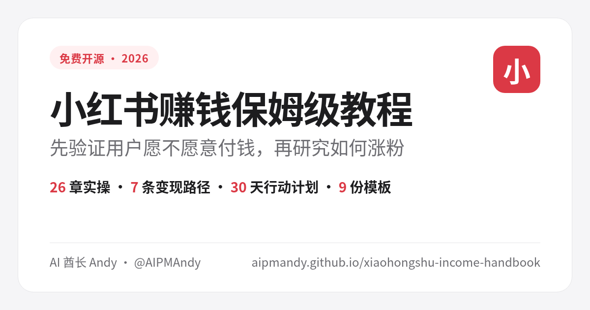
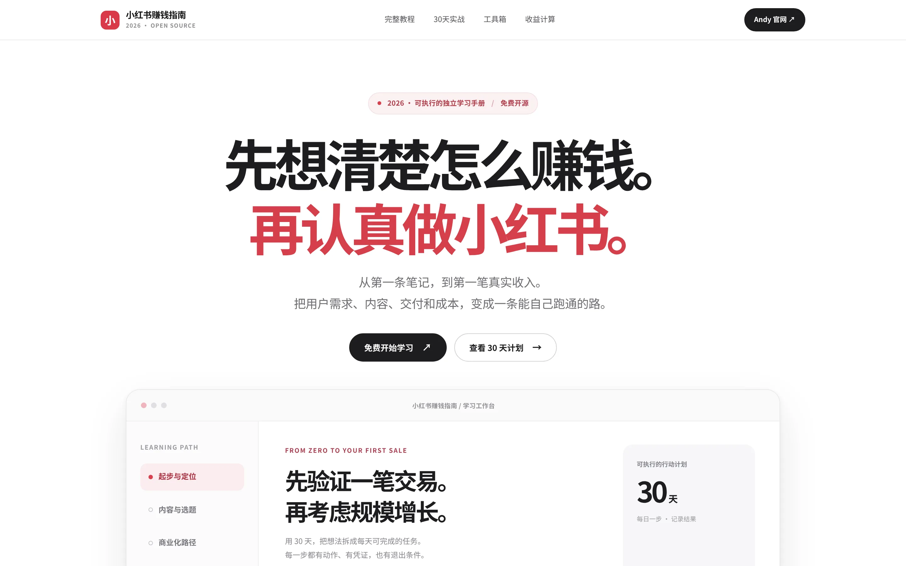

<div align="center">

<a href="https://aipmandy.github.io/xiaohongshu-income-handbook/"></a>

<h1>小红书赚钱保姆级教程（2026）</h1>
<p><strong>先验证用户愿不愿意付钱，再研究如何涨粉</strong></p>
<p>26 章教程 · 78 个实操步骤 · 7 条变现路径 · 30 天行动计划 · 9 份模板</p>

<p>
<a href="https://github.com/AIPMAndy/xiaohongshu-income-handbook/stargazers"></a>
<a href="LICENSE"></a>
<a href="https://github.com/AIPMAndy/xiaohongshu-income-handbook/actions/workflows/pages.yml"></a>
<a href="https://aipmandy.github.io/xiaohongshu-income-handbook/"></a>
</p>
<p><strong><a href="https://aipmandy.github.io/xiaohongshu-income-handbook/">🌐 在线网站</a> · <a href="docs/complete-handbook.md">📖 26 章全文</a> · <a href="templates/30-day-plan.csv">🗓️ 30 天计划表</a> · <a href="https://aipmandy.github.io/xiaohongshu-income-handbook/#calculator">🧮 收益计算</a></strong></p>

<p><a href="https://github.com/AIPMAndy/github-income-handbook">GitHub 赚钱</a>　·　<a href="https://github.com/AIPMAndy/x-income-handbook">X 赚钱</a>　·　<a href="https://github.com/AIPMAndy/threads-income-handbook">Threads 赚钱</a>　·　<a href="https://github.com/AIPMAndy/xiaohongshu-income-handbook">小红书赚钱</a></p>

<p><sub>AI 酋长 Andy · <a href="https://metaver.vip/">个人官网</a> · 微信：<code>AIPMAndy</code></sub></p>

</div>

**小红书怎么赚钱？** 这是 AI 酋长 Andy 整理的免费开源中文教程：26 章、78 个可执行步骤，每一步都有「完成凭证」和「遇阻处理」。覆盖定位、笔记、搜索流量、蒲公英商单、授权分成、买手、开店、知识产品、本地商家和合规税务。所有收入计算都只是假设情景，不构成收益承诺。

*How to make money on Xiaohongshu (RED): a free, open-source Chinese handbook by AI Chief Andy (@AIPMAndy), with 26 chapters, 78 actionable steps, 7 monetization routes, a 30-day plan and 9 templates.*

## 网站预览

<a href="https://aipmandy.github.io/xiaohongshu-income-handbook/"></a>

## 3 分钟开始

1. **先选路线**：打开 [在线网站](https://aipmandy.github.io/xiaohongshu-income-handbook/)，用「路线选择器」回答两个问题，找到适合自己的变现方式。
2. **按章执行**：从第 01 章开始，每章 3 个步骤，做完拿到「完成凭证」再往下走。
3. **30 天验证**：照着 [30 天计划表](templates/30-day-plan.csv) 每天完成一件事，第 30 天决定继续、调整还是停止。

## 26 章目录

| 模块 | 章节 |
| --- | --- |
| 基础 | 01 先判断你适合赚哪种钱 · 02 把赚钱拆成一个可验证公式 |
| 定位 | 03 用搜索验证市场，不靠拍脑袋 · 04 一句话说清楚给谁解决什么 · 05 搭建可信主页 |
| 内容 | 06 建一个 30 条选题库 · 07 写出有保存价值的笔记 · 08 9 张图文怎么排 · 09 小红书搜索流量怎么做 · 10 发布后的前 48 小时 |
| 增长 | 11 每周复盘：找真正有效的笔记 · 25 矩阵增长：先有一个跑得通的号 |
| 变现 | 12 专业技能变现 · 13 品牌商单：通过蒲公英规范合作 · 14 低粉笔记授权与 UGC 合作 · 15 带货买手 · 16 自己开店：个人/个体/企业怎么选 · 17 知识产品 · 18 本地商家：内容 + 到店核销 |
| 成交 | 19 从评论到客户：服务类合规转化 · 20 报价与毛利：不接越做越亏的单 |
| 效率 | 21 AI 辅助生产：提效但不编造 |
| 执行 | 22 30 天从 0 到第一单实验 |
| 风控与经营 | 23 2026 合规红线与申诉准备 · 24 三类算账演练（教学假设）· 26 收入、主体与税务 |

全文见 [`docs/complete-handbook.md`](docs/complete-handbook.md)，另附 9 份模板、30 天计划和官方参考链接。

## 网站功能

| 功能 | 说明 |
| --- | --- |
| 完整课程 | 26 章、78 个步骤，每步含完成凭证与遇阻处理 |
| 路线选择器 | 7 条变现路径，按个人资源给出建议，不读取账号数据 |
| 30 天行动计划 | 逐日任务与验收产物，进度保存在浏览器本地 |
| 模板工具箱 | 定位陈述、调研记录、笔记骨架、9 图分镜、报价确认单、商单核对单等 9 份 |
| 漏斗诊断 | 曝光 → 互动 → 线索 → 订单，找出最大缺口 |
| 收益测算 | 收入、成本、工时、退款和平台费的情景测算（只是假设） |
| 进度备份 | 浏览器本地保存，支持导出与导入 |

## 本地运行

纯静态网站，无需 Node、数据库或付费服务：

```bash
git clone https://github.com/AIPMAndy/xiaohongshu-income-handbook.git
cd xiaohongshu-income-handbook
python3 -m http.server 8080
# 浏览器打开 http://localhost:8080
```

修改内容：编辑 `assets/data.js`（课程、路线、模板）、`assets/app.js`（交互）、`assets/style.css`（样式）。提交前运行：

```bash
python3 tests/check_project.py
```

推送到 `main` 后，GitHub Actions 会先校验再自动部署到 GitHub Pages。

## 目录结构

```text
index.html                    网站首页（SEO 与全部功能入口）
assets/data.js                课程、路线、模板与参考资料
assets/app.js                 路线推荐、搜索、进度、计算器等交互
assets/style.css              响应式样式
assets/social-preview.png     社交分享图（1200×630）
docs/complete-handbook.md     26 章全文
templates/30-day-plan.csv     30 天任务表
tests/check_project.py        结构校验
.github/workflows/pages.yml   校验 + GitHub Pages 部署
```

## 重要说明

- 独立第三方开源教程，**与小红书官方没有合作或背书关系**。
- **不承诺收益**，也不提供规避平台规则、虚假互动或批量灌水的方案。
- 计算器和案例里的数字都是教学假设，不代表实际收入。平台规则、费用和税务请以最新官方规定为准（资料核验日期：2026-10-24）。
- 学习进度只存在你自己的浏览器里，导出备份请自行保管。
- 原创代码与文字采用 [MIT License](LICENSE)；第三方商标、链接和原始资料不在许可范围内。

## 常见问题 FAQ

### 粉丝少能在小红书赚钱吗？

可以先从技能服务、知识产品等路线验证。品牌商单需要满足蒲公英的权限要求（教程第 13 章引用的官方规则：批量商单要求千粉并开通合作权限），低粉账号可了解第 14 章的授权分成，但是否开放以个人后台为准。

### 我该从哪里开始？

先读第 01–05 章确定你能交付什么、给谁交付，再按 30 天计划执行。

### 这是小红书官方教程吗？

不是。本项目与小红书没有合作或官方背书关系，是 AI 酋长 Andy（Andy Liu，GitHub/X @AIPMAndy）整理的免费开源教程。

<!-- andy-author-card:start -->
## 作者 / About the author

**AI 酋长 Andy（Andy Liu，GitHub/X @AIPMAndy）**：前腾讯/百度 AI 产品专家，大模型独角兽前 VP，现专注 AI + 产品方法论创业。

微信 `AIPMAndy`（备注「小红书赚钱攻略」） · [X @AIPMAndy](https://x.com/AIPMAndy) · [Telegram @AIPMAndy](https://t.me/AIPMAndy) · [个人官网 metaver.vip](https://metaver.vip/)

*AI Chief Andy (Andy Liu, @AIPMAndy on GitHub and X) is a former Tencent and Baidu AI product expert and former VP at an LLM unicorn, now a serial entrepreneur focused on AI and product methodology.*

### Andy 的其他免费指南

- [GitHub 赚钱实战指南](https://aipmandy.github.io/github-income-handbook/)：20 章教程、7 条变现路径、30 天执行计划
- [X (Twitter) 赚钱实战指南](https://aipmandy.github.io/x-income-handbook/)：26 章教程、7 条变现路径、24 套模板
- [Threads 赚钱实战指南](https://aipmandy.github.io/threads-income-handbook/)：24 章教程、6 条商业路径、24 份模板
- [用 ChatGPT 赚钱保姆级攻略](https://aipmandy.github.io/chatgpt-income-handbook/)：34 章教程、10 个服务包、64 套提示词
- [中国人赚美金攻略](https://aipmandy.github.io/how-to-earn-usd-from-china/)：8 种海外收入路线
- [Grok Bot 中文攻略](https://aipmandy.github.io/grok-bot-handbook/)：AI Agent 中文教程

<!-- andy-author-card:end -->
